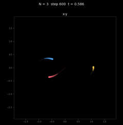
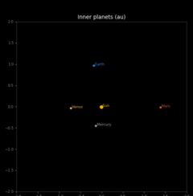
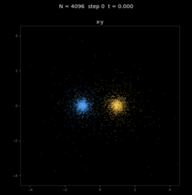
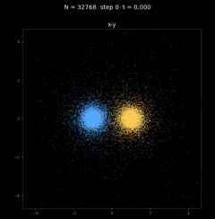

# AI を使ったアプローチ（登戸浦版 MNCL 編）

MNCL を使うと、MN-Core 2 の計算（kernel）を OpenCL C に近い書き方で書けます。このページでは、
登戸浦版 MNCL の位置づけと、AI に書かせるときに何を読み込ませればよいかを紹介します。
[AI を使ったアプローチ（vsm 編）](ai-vsm.md) を先に読んでおくと、わかりやすくなります。
用語は [用語集](terms.md) を参照してください。

## 登戸浦版 MNCL とは

- もとは、MN-Core（無印）用の LLVM のコンパイラです。「OpenCL 風の何か」への答えとして、2022 年から
  神戸大学と一緒に開発していました（神戸版）。
- 神戸大学 惑星科学研究センター（CPS）の閉鎖（2026 年 3 月）に伴い、神戸版をあらため登戸浦版として、
  MN-Core 2 版で再出発しました。
- 登戸浦版 MNCL は、PFN の MNCL とは別のもので、本家ではありませんが、元祖です。

## MNCL が提供するもの

- **OpenCL C から _vsm へのコンパイル**: `.cl` に書いた kernel を `_vsm` にします。`_vsm` は、ほぼ
  `.vsm` と同じもの（vsm のアセンブリ）です。違いは、vsmlink の directive（`@distribute` など）が入っている
  ことと、PDM のアドレスなどがまだ決まっていないことだけです。vsmlink が、配置パラメタ（`.param`、`.stparam`）に従って、`_vsm` を assemble3 にかけられる `.vsm` に
  変換します。
- **疑似関数（MNCL 拡張 API）**: データを PE に配る・集める・隣の PE から受け取るなどの処理を、関数の
  形で書けます（`distribute`、`collect`、`broadcast`、`get_neighbor`、`reduce_add` など）。ふつうの関数の
  ように呼び出されるのではなく、MNCL がこれらを vsmlink の directive に変換します。
- **double3、double4**: ベクトル型を扱えます。
- **persistent**: いちばん大きい機能です。kernel の実行をまたいで、値を PE に残せます。ホストとの間で
  データを往復させずに、kernel を何度も実行できます。特殊な機能です。

## MNCL が提供しないもの

MNCL は、計算（kernel）を書くことに絞っています。次の機能は、MNCL の外に出しています。

| 機能 | 担当 |
|------|------|
| アドレスの割り当て（PDM のどのアドレスに何を置くかなど） | vsmlink の配置パラメタ（`.param`、`.stparam`） |
| 疑似関数の展開（directive から実際の命令の並びへ） | vsmlink |
| ホストとの転送、kernel の読み込みと実行 | libmnc2（ホストの C プログラム） |

したがって、**MNCL だけではプログラムできません。** MNCL、vsmlink、libmnc2 の 3 つを組み合わせて使います。
MNCL の疑似関数は vsmlink の directive に変換されるので、どんな疑似関数が使えるかを知るにも、
vsmlink の情報が必要です。

## AI に読み込ませるもの

[vsm 編](ai-vsm.md) の資料（PFN の開発者マニュアル、MN-Core Challenge の資料、
libmnc2-kit）に加えて、次の 2 つを読み込ませます。

| # | 資料 | 入手先 | 読み込ませる理由 |
|---|------|--------|------------------|
| 4 | この SDK の mncl-kit（説明書、ヘッダ、サンプル） | [GitHub Releases](https://github.com/Nobuto-Ura-HPC-Hub/open-mncore2-sdk/releases) の `mncl-kit-*.tar.gz` | 疑似関数の使い方と、.cl の書き方 |
| 5 | この SDK の vsmlink-kit（directive と配置パラメタの仕様） | 同じく `vsmlink-kit-*.tar.gz` | 疑似関数が何に変換されるか、アドレスの割り当て（`.param`、`.stparam`）の書き方 |

vsm 編と同じく、tarball を取ってきて手元に展開し、中身をすべて読み込ませるのが手軽です。

頼み方は vsm 編と同じです。何を計算するかと設計を決めてから、AI に .cl、配置パラメタ、ホストの C
プログラムを書かせ、試行錯誤させます。

## vsm と MNCL の使い分け

- **融通が利くのは、vsm を直接書くほうです。** レジスタを有効に使うなどの細かい処理は、MNCL では
  かえって面倒になることがあります。
- MNCL は、将来的にはコンパイラとして非常に有効です。ただし、今の時点で MNCL で作れることが
  確かめられているアプリは、N 体計算と odd-even-sort（奇偶転置ソート）です。

## 結果として、何ができたか

MNCL で作った N 体計算の結果です。詳しくは The N-Body Shop 登戸浦支店で紹介しています。

<table style="table-layout: fixed; width: 100%;">
<tr><th><a href="https://nobuto-ura-hpc-hub.github.io/n-bodyshop-japan/results/3body.html">3 体問題</a></th><th><a href="https://nobuto-ura-hpc-hub.github.io/n-bodyshop-japan/results/solar.html">太陽系</a></th><th><a href="https://nobuto-ura-hpc-hub.github.io/n-bodyshop-japan/results/plummer-4096.html">4096 粒子の球状星団の衝突</a></th><th><a href="https://nobuto-ura-hpc-hub.github.io/n-bodyshop-japan/results/plummer-32k.html">32K 粒子の球状星団の衝突</a></th></tr>
<tr><td></td><td></td><td></td><td></td></tr>
</table>
