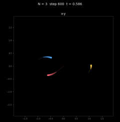
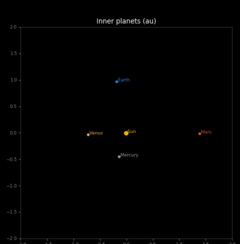
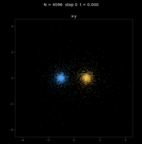
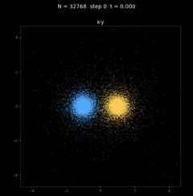

# Open MN-Core 2 SDK

**Open MN-Core 2 SDK** は、MN-Core 2 で動く計算を書いて動かすための開発環境です（非公式プロジェクト。
Preferred Networks, Inc. の公式配布ではありません。詳細は [README](https://github.com/Nobuto-Ura-HPC-Hub/open-mncore2-sdk#disclaimer) の Disclaimer を参照）。

このドキュメントは v0.6.0 に対応しています。

## できること

- **計算（kernel）を書く**: OpenCL C で書いて MNCL でコンパイルする方法と、MN-Core 2 のアセンブリ
  （.vsm）を書いて vsmlink で配置を決める方法があります
- **ホストから動かす**: C のプログラムから libmnc2 を使い、kernel の読み込み、データの送受信、
  kernel の実行を行います
- **同じプログラムを、エミュレータと実機の両方で動かす**: 手元の PC ではエミュレータで、
  PFCP（Preferred Computing Platform）では MN-Core 2 の実機で動かせます

## 結果として、何ができたか

MNCL で作った N 体計算の結果です。詳しくは The N-Body Shop 登戸浦支店で紹介しています。

| 3 体問題 | 太陽系 | 4096 粒子の球状星団の衝突 | 32K 粒子の球状星団の衝突 |
|----------|--------|---------------------------|--------------------------|
|  |  |  |  |

## 目次

1. [MN-Core 2 とは](mncore2.md)
2. [MN-Core 2 に合わせたプログラムの作り方](programming.md)
3. [AI を使ったアプローチ（vsm 編）](ai-vsm.md)
4. [AI を使ったアプローチ（登戸浦版 MNCL 編）](ai-mncl.md)
5. [HPC と分散メモリ](hpc.md)
6. SDK を使える環境を用意する
   - [PFCP で使う](pfcp.md) — 実機で動かす。インストール不要。SDK を入れたコンテナイメージから
     pod を作る
   - [手元の PC で使う](local.md) — エミュレータで確かめる。PFN の `mncore-sdk` と SDK の kit を
     インストールする
7. [SDK でプログラムを作る流れを知り、サンプルを動かす](tools.md)
8. [SDK の各 kit の説明書を読む（リファレンス）](./reference/README.md)
9. [用語集](terms.md)

## ソフトウェアの層

| 層 | 役割 | 提供 |
|----|------|------|
| アプリ（.cl、.vsm、ホストの C） | 計算とその呼び出しを書く | 利用者 |
| MNCL | OpenCL C のコンパイラ。.cl から _vsm を出力する | この SDK |
| vsmlink | _vsm と配置パラメタから、実行できる .vsm を出力する | この SDK |
| assemble3 | アセンブラ。.vsm から命令列を作る | PFN（`mncore-sdk`） |
| libmnc2 | ホスト側のライブラリ | この SDK |
| エミュレータ（gpfn3_package_main） | 実機の代わりに実行する | PFN（`mncore-sdk`） |
| libgpfn3、ドライバ、MN-Core 2 | 実機 | PFN |
