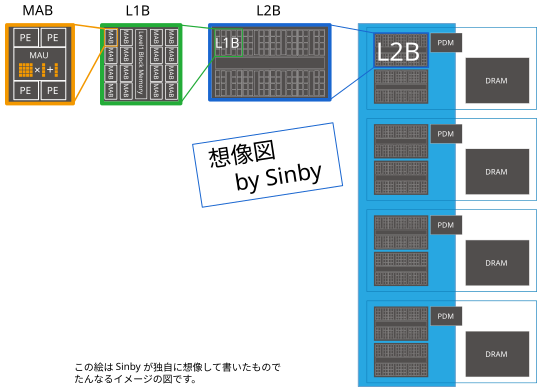

# MN-Core 2 の概要


MN-Core 2 は、Preferred Networks（PFN）が開発した、SIMD 方式のアクセラレータです。
このページでは、MN-Core 2 の構成と、プログラムを組み立てるときの一般的な考え方を説明します。
用語は [用語集](terms.md) を参照してください。

## 概要

- **SIMD**: 多数の PE（Processing Element）が、同じ命令を、それぞれ異なるデータに対して実行します。
- **命令の流れは 1 本**: PE は、プログラムカウンタも命令デコーダも持ちません。すべての PE が完全に
  同期して動き、ホストから送られた 1 本の命令列を実行します。分岐のような制御の構造は、命令列には
  ありません。
- **キャッシュがない**: ボードの中のデータの転送は、すべて命令で明示的に指定します。キャッシュの
  代わりに、各階層にメモリ（SRAM）があり、PE の近くには大容量のローカルメモリがあります。

## チップの構成

1 ボードに 1 チップが載っています。チップは、木のような階層の構造になっています。



（図は理解のためのイメージで、実際の物理的な配置を表すものではありません）

| 階層 | 子の数 | チップ全体の数 |
|------|--------|----------------|
| チップ（トップレベル） | L2B を 8 個 | 1 |
| L2B（Level 2 Block） | L1B を 8 個 | 8 |
| L1B（Level 1 Block） | MAB を 16 個 | 64 |
| MAB（Matrix Arithmetic Block） | PE を 4 個と、MAU（行列演算ユニット）を 1 個 | 1024 |
| PE | — | **4096** |

L2B は 2 つずつ、全部で 4 つの**グループ**に分かれています。各グループに、PDM と DRAM が 1 つずつ
付いています。

### 主な仕様

| 項目 | 値 |
|------|----|
| 動作クロック | 750 MHz |
| PE の数 | 4096 |
| ピーク性能（fp64） | 12 TFlops |
| ピーク性能（fp32） | 49 TFlops |
| 消費電力 | 330 W（設計値） |

出典: PFN「MN-Core 2 ホワイトペーパー」（ver 0.1、2023-11-10）

## データの幅

このページでは、データの幅（ビット数）を u16 / u32 / u64 で表します。これは型の名前ではなく、
幅の単位です（u16 = 16 ビット、u32 = 32 ビット、u64 = 64 ビット）。メモリの容量も、
「8 Ki u64」（8192 × 64 ビット）のように、この単位で表します。

## メモリの階層

```
ホスト
  ⇕ PCIe（第 0 グループの PDM だけがホストとつながる）
PDM（グループあたり 4 MiB）   DRAM（グループあたり 4 GiB）
  ⇕ 上位記憶どうしの転送（PDM、DRAM、L2BM の間）
L2BM（L2B ごとに 32 Ki u64）
  ⇕
L1BM（L1B ごとに 8 Ki u64）
  ⇕
PE ごとのメモリ:
  ├── LM0 / LM1（各 2 Ki u64）
  ├── GRF0 / GRF1（各 256 u64）
  └── T レジスタ（8 u64）
```

- ホストとの入出力は、すべて第 0 グループの PDM を経由します。
- DRAM がメインメモリの役割を果たします。
- PDM、DRAM、L2BM の 3 つを**上位記憶**と呼びます。
- PDM と DRAM の最小のアクセス単位は 1 u64 です。L2B より下も u64 が基本で、PE では u32 と
  2 u64（128 ビット）のアクセスもできます。
- 値の格納はビッグエンディアンです。

## 演算の種類

PE の演算は、16 / 32 / 64 ビットのそれぞれについて、整数と浮動小数点数があります。

| 幅 | 整数 | 浮動小数点数 |
|----|------|--------------|
| 16 ビット | 符号なし・符号あり | E6M9（符号 1、指数部 6、仮数部 9 ビット） |
| 32 ビット | 符号なし・符号あり | fp32（符号 1、指数部 8、仮数部 23 ビット） |
| 64 ビット | 符号なし・符号あり | fp64（符号 1、指数部 11、仮数部 52 ビット） |

- 符号ありの整数は、2 の補数で表します。
- E6M9 は、IEEE 754 の binary16（指数部 5、仮数部 10 ビット）とは、指数部と仮数部のビット数が
  違います。
- 浮動小数点数には、非正規化数と NaN がありません。
- 1 u64 のデータに E6M9 の演算を行うと、1 u64 に含まれる 4 つの u16 に対して同時に演算します。

## プログラムの組み立て方

命令は、上位記憶（PDM、DRAM、L2BM）の間の転送を行う [MV 命令](terms.md#命令)と、L2B より下を制御する
[PE 命令](terms.md#命令)の 2 種類です。データを PE まで運ぶ方法、命令の間の待ち、分岐の代わりのマスクなどは、
[MN-Core 2 に合わせたプログラムの作り方](programming.md) を参照してください。

## 参考資料

- PFN: MN-Core 2 ホワイトペーパー
- PFN: MN-Core 2 ソフトウェア開発者マニュアル
- https://projects.preferred.jp/mn-core/
