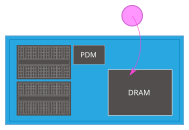
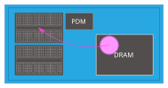
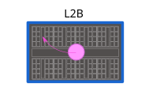
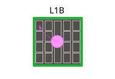
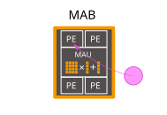
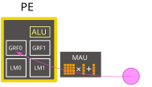

# MN-Core 2 に合わせたプログラムの作り方

MN-Core 2 でプログラムを作るときに、ふつうの CPU と違って意識しなければならないことをまとめます。
構成とメモリの階層は [MN-Core 2 とは](mncore2.md) を、用語は [用語集](terms.md) を参照してください。

## 1. データを PE まで運ぶ

MN-Core 2 の命令は、次の 2 種類です。

| 命令 | 行うこと | 進み方 |
|------|----------|--------|
| MV 命令 | PDM、DRAM、L2BM の間のデータ転送 | 発行したあと、後に続く命令とは非同期に進む |
| PE 命令 | L2B より下のデータ転送（L2BM と L1B の間、L1BM と PE の間）と、PE・MAU の演算 | 1 命令で 4 サイクル（1 ステップ）を制御する |

PE が計算に使えるのは、PE ごとのメモリ（GRF0 / GRF1、LM0 / LM1、T レジスタ）にあるデータだけです。
キャッシュはないので、計算の前に、データを階層の上から順に、命令で PE まで運びます。

| # | 図 | 転送 |
|---|----|------|
| 1 |  | ホストからボードへ。ホストとの入出力は、すべて第 0 グループの PDM を経由します。PDM から DRAM へは MV 命令で運びます（図では、ホストから DRAM へ直接入るように描いています） |
| 2 |  | DRAM（または PDM）から L2B の L2BM へ（MV 命令） |
| 3 |  | L2BM から L1B の L1BM へ（PE 命令） |
| 4 |  | L1BM から MAB の PE へ（PE 命令） |
| 5 |  | MAB の中の PE へ |
| 6 |  | PE の中の GRF0 / GRF1 / LM0 / LM1 のどれかへ |

- PDM、DRAM、L2BM の間の転送は **MV 命令**、L2BM より下（L1BM、PE）の転送と演算は
  **PE 命令**で行います。
- 結果を返すときは、逆の順にたどります。上位から下位へ等分して配る転送（ディストリビュート）には、
  下位から上位へ集める転送（コレクト）が対になっていて、配ったデータをそのまま集めると、元と同じ
  並びに戻ります。

## 2. 1 本の命令列と、ステップ・サイクル


- ボード全体に対して、命令の流れは 1 本です。PE 命令は、1 命令で L2B より下の全体を 4 サイクル
  制御します。この 4 サイクルを**ステップ**と呼びます。
- 命令の流れには 2 つのモードがあります。
  - **auto stride モード**: ステップの中で、サイクルごとにアドレスに一定の増分が加わります。1 つの
    命令で、4 サイクル分の異なるデータを処理できます。
  - **flat モード**: GRF0、GRF1、LM0、LM1 のアドレスをサイクルごとに指定できます。アドレスの指定は
    柔軟になりますが、命令の量（帯域）は増えます。

## 3. 待ちを入れる（ハザードの回避）

命令の実行はパイプラインになっていて、発行した直後には結果を使えません。命令の間に、必要な数の
ステップを空けます。空ける理由は 2 種類あります。

- **データ競合**: 書き込みが終わるまで、読み出しを待つ必要がある。同じアドレスを読み書きするときだけ
  起こる。
- **ポート衝突**: アドレスの信号線などのハードウェアが空くのを待つ必要がある。アドレスによらず起こる。

PE のメモリの例です。

| 書き込んだ先 | 読み出すまでに空けるもの | 理由 |
|--------------|--------------------------|------|
| LM0 / LM1 | 2 ステップ | ポート衝突 |
| GRF0 / GRF1 | 同じアドレスなら 1 ステップ（違うアドレスなら同時に読み書きできる） | データ競合 |
| T レジスタ | 1 ステップ | データ競合 |

正確には、PE のメモリ（マスクレジスタを除く）への書き込みを伴う命令は、完了まで 6 サイクルかかります。
次のアセンブリは、正しくアセンブルできます。

```
imm f"1.0" $r0/1000
nop
dvadd $lm0v $r0e $ln0v
```

`/1000` は書き込みマスクの指定で、ステップの 4 サイクルのうち、最初のサイクルだけで `$r0` に書き込みます。
そのあと `nop` の 1 ステップと合わせて、`dvadd` が始まるまでに 7 サイクル空くので、6 サイクルの条件を
満たします。`/0010`（3 サイクル目だけで書き込む）にすると、空きが 6 サイクルより少なくなるので、
アセンブラがエラーにします。

**これらの条件は、アセンブラがすべて検査し、違反しているとエラーにします。**

## 4. 分岐の代わりにマスクを使う

命令の流れには、分岐のような制御の構造がありません。すべての PE が、同じ命令を同じ順に実行します。

条件によって処理を変えたいときは、**マスクレジスタ**を使います。

- **書き込みマスク**: フラグが 0 の箇所では、書き込みを行わない。
- **ゼロフラッシュマスク**: フラグが 0 の箇所では、演算結果を 0 にする。

これで、疑似的な条件分岐を作れます。マスクレジスタは 32 エントリあり、そのうち 15 エントリを、
ALU や MAU の演算結果のフラグで書き換えられます（残りは固定値）。書き込んだフラグは、次のステップから
使えます。

## 5. 転送と計算を重ねる

MV 命令は、発行したあと、後に続く命令とは非同期に進みます。

- PE 命令の後に MV 命令を発行したいときは、その順に命令を並べます。
- MV 命令の完了を待ってから PE 命令を実行したいときは、PE 命令の **wait** で待ちます。

PDM、DRAM、L2BM の間の転送（MV 命令）と、PE での計算（PE 命令）を重ねることで、演算器を遊ばせずにすみます。

## 6. 課題

ここまでのとおり、MN-Core 2 のプログラムを直接書くには、次のようなことを人が考える必要があります。

- 命令の間に空けるステップの数を、命令の組み合わせごとに数える
- メモリの容量（L1BM は 8 Ki u64、LM0 は 2 Ki u64 など）に合わせて、データを分けて運ぶ
- ディストリビュートとコレクトで、データをどの PE にどう並べるかを決める
- 転送と計算を重ね、演算器が止まっている時間を減らす

これらをどう楽にするかが、「AI を使ったアプローチ」（[vsm 編](ai-vsm.md)、[登戸浦版 MNCL 編](ai-mncl.md)）の話につながります。

また、扱うデータの数が PE の数（4096）を超える場合の分け方や、PE を無駄なく使う方法は、
[HPC と分散メモリ](hpc.md) で述べます。

## 参考

- PFN: MN-Core 2 ソフトウェア開発者マニュアル（1 章、3.6.2、3.6.3）
- Sinby: [MN-Core2 チュートリアルの最初の方](https://sinby.com/posts/2024/03130.html)（2024-03-13。図の出典）
